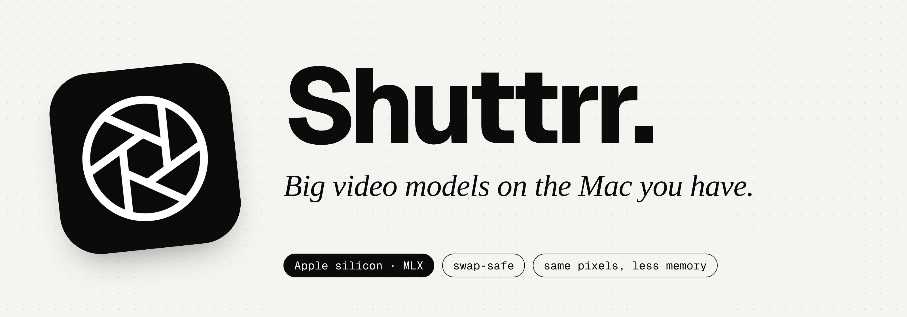

<p align="center">
  <picture>
    <source media="(prefers-color-scheme: dark)" srcset="docs/assets/banner-dark.png">
    
  </picture>
</p>

<p align="center">
  <b>A Mac-native engine for big video and image models.</b><br>
  Runs them in a fraction of the memory, gives you the same pixels, and never pushes your Mac into swap.
</p>

<p align="center">
  <a href="#install">Install</a> ·
  <a href="#measured-results">Measured results</a> ·
  <a href="#models">Models</a> ·
  <a href="#use-it-from-other-apps">Use it from other apps</a> ·
  <a href="docs/INSTALL.md">Full guide</a>
</p>

---

## Why Shuttrr

Video diffusion models are huge. LongCat-Video-Avatar wants about 34 GB of memory at 720p, which rules out
most Macs and fights with everything else you have open.

Shuttrr runs the same model in about **14 GB** by reading the weights from your SSD a few blocks at a time,
and the video that comes out is **identical, bit for bit**. It costs about 5% more time.

- **Same output, less memory.** Every low-memory step that is on by default is checked to give the exact
  same frames as the full-memory run.
- **Never into swap.** A request starts only when it fits in free memory with room to spare. If the Mac
  starts swapping during a run, Shuttrr stops the request and frees the memory.
- **One app, no Terminal.** Download the app, open it, pick a model. It installs its own engine and
  downloads the weights for you.
- **Plays well with others.** A local HTTP API, an OpenAI-compatible images endpoint and a ComfyUI node pack.
  It reads from local LLM servers such as oMLX, but never unloads or changes them.

## Install

**The app (recommended).** Download `Shuttrr.dmg` from [Releases](../../releases), drag Shuttrr to
Applications and open it. The first-run window checks your Mac, installs the engine into `~/.shutter`, and
offers the models. No Python, Homebrew or Terminal needed.

**From source.**

```bash
git clone https://github.com/<owner>/shuttrr && cd shuttrr
scripts/install.sh                         # engine in ~/.shutter/venv, Shuttrr.app in ~/Applications
shutter doctor                             # is this Mac ready?
shutter download longcat-avatar-1.6-8bit   # 37.5 GB from Hugging Face
```

### Requirements

| | |
| --- | --- |
| Mac | Apple silicon (M1 or newer), macOS 14 or newer |
| Memory | **24 GB or more** for LongCat. 16 GB Macs are not supported yet (see [Known limits](#known-limits)). |
| Disk | About 40 GB free for LongCat |

## Make your first video

In the app, press **New request**, add a face image and a voice clip, and press Run. Or from Terminal:

```bash
shutter submit --model longcat-avatar-1.6-8bit \
  --image face.png --audio voice.wav \
  --prompt "a person talking to the camera" --wait
```

The video lands in `~/.shutter/outputs/`.

## Measured results

LongCat-Video-Avatar 1.6 (8-bit), 93 frames, 8 steps, on an M5 Max with 128 GB. Peak is the MLX memory peak
for the whole request. "Identical" means every frame of the video matched the full-memory run exactly.

**704×1312**

| Memory step | Peak memory | Time | Output |
| --- | --- | --- | --- |
| Full speed | 34.5 GB | 1,489 s | reference |
| Lowest memory | **13.8 GB** | 1,562 s (+4.9%) | identical, 93/93 frames |

**480p**

| Memory step | Peak memory | Time | Output |
| --- | --- | --- | --- |
| Full speed | 31.5 GB | 423 s | reference |
| Lower memory | 12.3 GB | 454 s (+7.3%) | identical, 93/93 frames |
| Lowest memory | 12.9 GB | 451 s (+6.5%) | identical, 93/93 frames |

Results on other Macs are not measured yet. If you run Shuttrr on a different chip, please share your
numbers in an issue.

## How it saves memory

Shuttrr has two modes:

- **Fast** picks the fastest memory step that fits in your free memory right now. Most people never touch
  anything else.
- **Low memory** lets you choose the step yourself with a slider, from Full speed down to Lowest memory.

The low-memory steps split the work into stages, free each part of the model as soon as it is done, and on
the lowest steps stream the transformer blocks from the SSD while the GPU works. In the measured runs the
GPU waited less than 0.03 seconds in total for the SSD.

The one setting that changes the output is the half-size final decode (`vae_bf16`). It is off unless you
turn it on, and it matches the full decode at 46.6 dB.

## Models

| Model | Kind | Download | Status |
| --- | --- | --- | --- |
| [LongCat-Video-Avatar 1.6, 8-bit low-memory](https://huggingface.co/SarthakRawool/LongCat-Video-Avatar-1.6-MLX-8bit-LowMem) | talking video from image + audio | 37.5 GB | supported |

More model families are in progress.

## Use it from other apps

The engine listens on `http://127.0.0.1:8484` (local only by default).

- **Shuttrr API:** submit requests, watch progress, load and unload models. See [docs/API.md](docs/API.md).
- **OpenAI-compatible images:** `POST /v1/images/generations` and `/v1/images/edits`.
- **ComfyUI:** a node pack in [`integrations/comfyui`](integrations/comfyui).
- **Dashboard:** open `http://127.0.0.1:8484` in a browser.

To expose it on your network, set an `api_key` in `~/.shutter/config.json`. Clients then send
`Authorization: Bearer <key>`.

## Known limits

- **16 GB Macs:** LongCat does not fit yet. The guard needs about 12 GB free at 480p, and a 16 GB Mac with a
  browser open had 3.4 to 5.9 GB free in our tests.
- **Other Macs:** only measured on an M5 Max so far. Smaller chips will be slower, and the lowest steps read
  the model from the SSD on every step.
- **One request at a time.** Shuttrr runs heavy work one request at a time on purpose.

## Privacy

Everything runs on your Mac. Shuttrr only goes online to download models from Hugging Face.

## Docs

[Install guide](docs/INSTALL.md) · [API](docs/API.md) · [Modes](docs/MODES.md) ·
[Integrations](docs/INTEGRATIONS.md) · [Architecture](docs/ARCHITECTURE.md) · [Developing](docs/DEVELOPING.md)

## License

MIT. LongCat-Video-Avatar is by Meituan's LongCat team; see the model card for its license.
