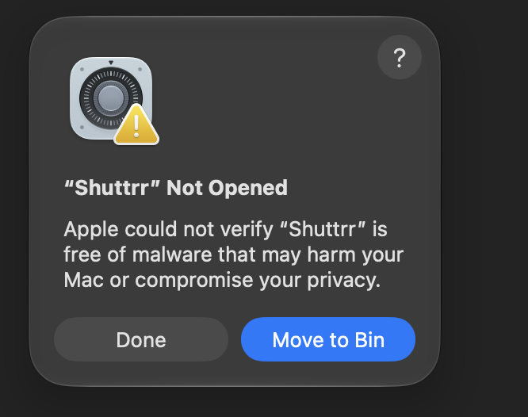
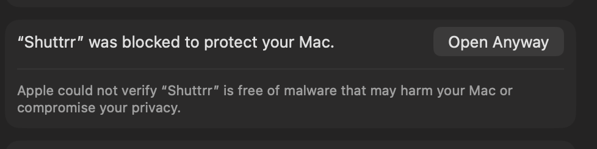

<p align="center">
  <picture>
    <source media="(prefers-color-scheme: dark)" srcset="docs/assets/banner-dark.png">
    
  </picture>
</p>

<p align="center">
  <b>A Mac-native engine for big video and image models.</b><br>
  Runs them in a fraction of the memory, gives you the same pixels, and never pushes your Mac into swap.
</p>

<p align="center">
  <a href="#install">Install</a> ·
  <a href="#measured-results">Measured results</a> ·
  <a href="#models">Models</a> ·
  <a href="#use-it-from-other-apps">Use it from other apps</a> ·
  <a href="docs/INSTALL.md">Full guide</a>
</p>

---

## Why Shuttrr

Video diffusion models are huge. LongCat-Video-Avatar wants about 34 GB of memory at 720p, which rules out
most Macs and fights with everything else you have open.

Shuttrr runs the same model in about **14 GB** by reading the weights from your SSD a few blocks at a time,
and the video that comes out is **identical, bit for bit**. It costs about 5% more time.

- **Same output, less memory.** Every low-memory step that is on by default is checked to give the exact
  same frames as the full-memory run.
- **Never into swap.** A request starts only when it fits in free memory with room to spare. If the Mac
  starts swapping during a run, Shuttrr stops the request and frees the memory.
- **One app, no Terminal.** Download the app, open it, pick a model. It installs its own engine and
  downloads the weights for you.
- **Plays well with others.** A local HTTP API, an OpenAI-compatible images endpoint and a ComfyUI node pack.
  It reads from local LLM servers such as oMLX, but never unloads or changes them.

## Install

**One line (easiest).** Paste this into Terminal. It downloads the latest app into Applications and opens
it, with no security prompt:

```bash
curl -fsSL https://raw.githubusercontent.com/sarthakrawool/shuttrr/main/scripts/install-app.sh | bash
```

**The DMG.** Download `Shuttrr.dmg` from [Releases](../../releases), drag Shuttrr to Applications and open
it. The first-run window checks your Mac, installs the engine into `~/.shutter`, and offers the models. No
Python, Homebrew or Terminal needed.

**"Shuttrr Not Opened" the first time?** Shuttrr is free and open source and isn't signed with a paid Apple developer certificate, so macOS asks once.

1. Press **Done** (not Move to Bin).

   

2. Open **System Settings**, then **Privacy and Security**, scroll down to "Shuttrr was blocked to protect your Mac." and press **Open Anyway**, then confirm with your password.

   

3. Shuttrr opens. You only do this once. The one-line installer above skips this step entirely.

**Updates.** From 0.2.1 on, Shuttrr updates itself: new versions download in the background, signed and
checked, and install when you restart Shuttrr. The engine in `~/.shutter` follows along; your models and
settings stay. Turn it off in Settings.

If you prefer, build it yourself from source below.

**From source.**

```bash
git clone https://github.com/sarthakrawool/shuttrr && cd shuttrr
scripts/install.sh                         # engine in ~/.shutter/venv, Shuttrr.app in ~/Applications
shutter doctor                             # is this Mac ready?
shutter download wan2.1-t2v-1.3b-8bit      # starter model: text to video, runs on a 16 GB Mac
shutter download longcat-avatar-1.6-8bit   # talking video, 37.5 GB from Hugging Face
```

**Starter model.** On a Mac with under 24 GB of memory the app recommends
[Wan 2.1 T2V 1.3B, 8-bit low-memory](https://huggingface.co/SarthakRawool/Wan2.1-T2V-1.3B-MLX-8bit-LowMem)
as the first model: one click in the app, no conversion. The model list has three sections for this Mac:
**Recommended** (measured here, full speed in at most half the memory), **Fits but barely** (up to 70% of the
memory, a lower memory step, or not tested on a Mac this size yet) and **Doesn't fit** (no Download button). Shuttrr
never offers a model on the promise that a low-memory step will squeeze it in. Once a model is installed, **Try a Sample** on the Models page makes a short
clip from a ready-made prompt (320×512, 17 frames, 12 steps: about a minute on a 16 GB M5) and opens it.

### Requirements

| | |
| --- | --- |
| Mac | Apple silicon (M1 or newer), macOS 14 or newer |
| Memory | **24 GB or more** for LongCat. Wan 2.1 1.3B runs on 16 GB. |
| Disk | About 18 GB free for the Wan starter model, about 40 GB for LongCat |

## Make your first video

In the app, press **New request**, add a face image and a voice clip, and press Run. Or from Terminal:

```bash
shutter submit --model longcat-avatar-1.6-8bit \
  --image face.png --audio voice.wav \
  --prompt "a person talking to the camera" --wait
```

The video lands in `~/.shutter/outputs/`.

## Measured results

LongCat-Video-Avatar 1.6 (8-bit), 93 frames, 8 steps, on an M5 Max with 128 GB. Peak is the MLX memory peak
for the whole request. "Identical" means every frame of the video matched the full-memory run exactly.

**704×1312**

| Memory step | Peak memory | Time | Output |
| --- | --- | --- | --- |
| Full speed | 34.5 GB | 1,489 s | reference |
| Lowest memory | **13.8 GB** | 1,562 s (+4.9%) | identical, 93/93 frames |

**480p**

| Memory step | Peak memory | Time | Output |
| --- | --- | --- | --- |
| Full speed | 31.5 GB | 423 s | reference |
| Lower memory | 12.3 GB | 454 s (+7.3%) | identical, 93/93 frames |
| Lowest memory | 12.9 GB | 451 s (+6.5%) | identical, 93/93 frames |

**Wan 2.1 T2V 1.3B, 33 frames, on a 16 GB M5 MacBook**

320×512, 20 steps:

| Memory step | Peak memory | Time | Output |
| --- | --- | --- | --- |
| Full speed (resident) | 6.23 GB | 166 s | reference |
| Split | 6.23 GB | 153 s | identical |
| Staged | **4.61 GB** | 163 s | identical |
| Streamed (wide) | 4.67 GB | 169 s | identical |
| Streamed (tight) | 4.67 GB | 160 s | identical |

Streamed output equals full-memory output bit for bit. All five steps gave the same frames.

480×832, 30 steps: staged with tiled decode peaked at 6.93 GB and took 676 s. The other steps at 480×832 did
not fit beside normal apps on 16 GB and were not measured.

Results on other Macs are not measured yet. If you run Shuttrr on a different chip, please share your
numbers in an issue.

## How it saves memory

Shuttrr has two modes:

- **Fast** picks the fastest memory step that fits in your free memory right now. Most people never touch
  anything else.
- **Low memory** lets you choose the step yourself with a slider, from Full speed down to Lowest memory.

The low-memory steps split the work into stages, free each part of the model as soon as it is done, and on
the lowest steps stream the transformer blocks from the SSD while the GPU works. In the measured runs the
GPU waited less than 0.03 seconds in total for the SSD.

The one setting that changes the output is the half-size final decode (`vae_bf16`). It is off unless you
turn it on, and it matches the full decode at 46.6 dB.

## Models

| Model | Kind | Download | Status |
| --- | --- | --- | --- |
| [LongCat-Video-Avatar 1.6, 8-bit low-memory](https://huggingface.co/SarthakRawool/LongCat-Video-Avatar-1.6-MLX-8bit-LowMem) | talking video from image + audio | 37.5 GB | supported |
| [Wan 2.1 T2V 1.3B, 8-bit low-memory](https://huggingface.co/SarthakRawool/Wan2.1-T2V-1.3B-MLX-8bit-LowMem) | text to video | 13.2 GB, one click (`shutter download wan2.1-t2v-1.3b-8bit`) | supported, starter model on 16 GB Macs |
| Wan 2.1 family (other 2.1 checkpoints and fine-tunes) | text to video | your own checkpoint, converted to 8-bit low-memory with `shutter convert` | early support |

Shuttrr accepts Wan 2.1 checkpoints in the official, diffusers and ComfyUI layouts, bare fine-tune files, and
LoRAs (official, PEFT and kohya names). `shutter inspect <path>` says what a checkpoint is and whether this Mac
can run it. A bare fine-tune file is only the video model: `shutter convert` takes the text encoder, tokenizer
and VAE from an installed Wan or LongCat model, or from folders you name.

Shuttrr refuses what it cannot run yet and says why: image-to-video models with a CLIP image branch, VACE,
Fun / control and camera models, speech-to-video and Animate models, fp8 and scaled-fp8 weights, and GGUF files.

## Use it from other apps

The engine listens on `http://127.0.0.1:8484` (local only by default).

- **Shuttrr API:** submit requests, watch progress, load and unload models. See [docs/API.md](docs/API.md).
- **OpenAI-compatible images:** `POST /v1/images/generations` and `/v1/images/edits`.
- **ComfyUI:** a node pack in [`integrations/comfyui`](integrations/comfyui).
- **Dashboard:** open `http://127.0.0.1:8484` in a browser.

To expose it on your network, set an `api_key` in `~/.shutter/config.json`. Clients then send
`Authorization: Bearer <key>`.

## Known limits

- **16 GB Macs:** LongCat does not fit yet. The guard needs about 12 GB free at 480p, and a 16 GB Mac with a
  browser open had 3.4 to 5.9 GB free in our tests.
- **Wan:** 480p at 81 frames, the streamed steps at 480p and the 14B models are not measured yet. On a Mac with
  under 24 GB, Wan makes 320×512 clips of 33 frames by default; short 480×832 clips work with the tiled decode
  (`vae_tile`), and 81-frame 480×832 clips did not fit beside normal apps on 16 GB.
- **Other Macs:** LongCat is only measured on an M5 Max and Wan on a 16 GB M5 so far. Smaller chips will be slower, and the lowest steps read
  the model from the SSD on every step.
- **One request at a time.** Shuttrr runs heavy work one request at a time on purpose.

## Privacy

Everything runs on your Mac. Shuttrr only goes online to download models from Hugging Face and, at launch
and once a day, to check GitHub for a new version and download it (turn it off in Settings). No analytics.

## Uninstall

Settings → **Uninstall Shuttrr…** in the app, or `shutter uninstall` (add `--keep-models` to keep the
downloaded models). Then drag Shuttrr.app to the Bin.

## Found a problem?

Press **Copy Diagnostics** on the app's Server tab and paste it into a
[new issue](../../issues/new/choose).

## Docs

[Install guide](docs/INSTALL.md) · [API](docs/API.md) · [Modes](docs/MODES.md) ·
[Integrations](docs/INTEGRATIONS.md) · [Architecture](docs/ARCHITECTURE.md) · [Developing](docs/DEVELOPING.md)

## License

MIT. LongCat-Video-Avatar is by Meituan's LongCat team; see the model card for its license.
